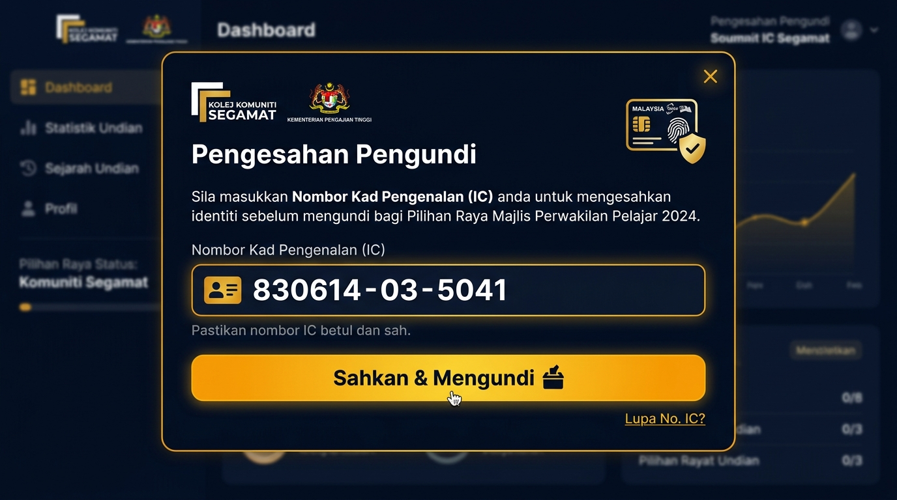
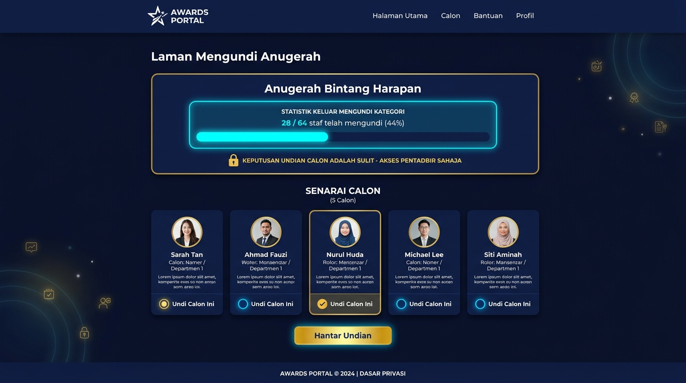
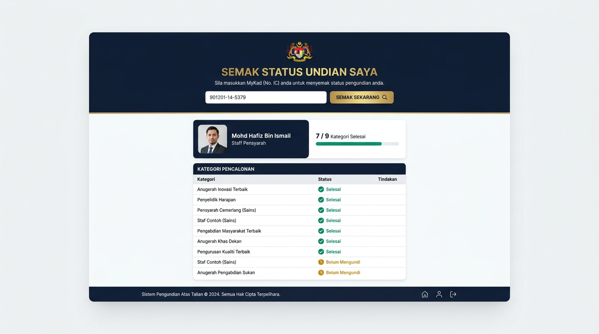
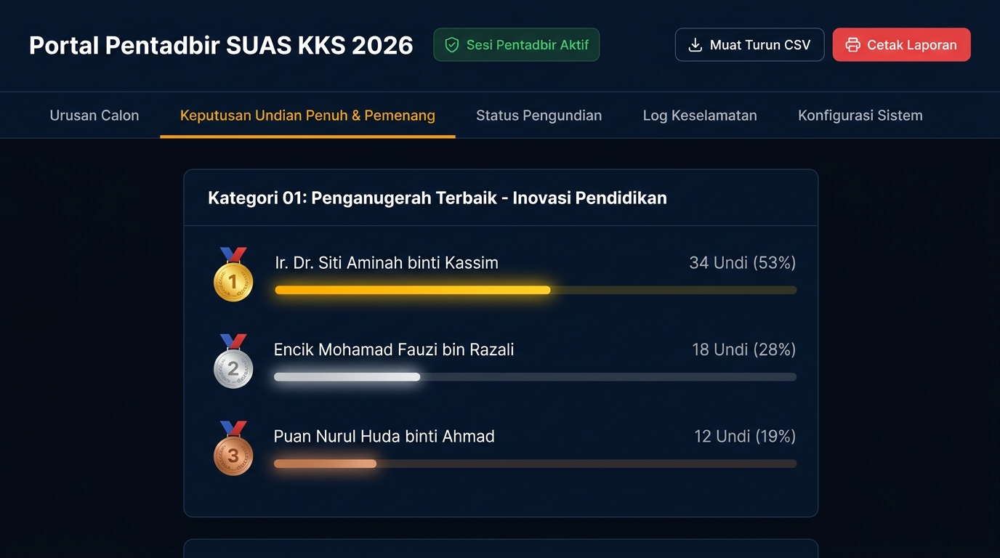

# MANUAL PENGGUNA SISTEM UNDIAN ANUGERAH SINERGI 2026 (SUAS KKS)
**KOLEJ KOMUNITI SEGAMAT, KEMENTERIAN PENDIDIKAN TINGGI**

---

## 1. PENGENALAN SISTEM

**SUAS KKS 2026** (*Sistem Undian Anugerah Sinergi Kolej Komuniti Segamat*) merupakan aplikasi web rasmi yang dibangunkan khusus untuk menguruskan proses pengundian 9 kategori anugerah penghargaan bagi Majlis Bengkel Sinergi Kecemerlangan Kolej Komuniti Segamat 2026.

### Ciri-ciri Utama Sistem:
- **Pangkalan Data 64 Warga KKS:** 49 orang Staff Pensyarah dan 15 orang Staff Admin yang disahkan layak mengundi.
- **Integriti 1 Undi Sahaja:** Setiap staf hanya dibenarkan mengundi **satu (1) calon sahaja bagi setiap kategori**.
- **Kerahsiaan Keputusan Terjamin:** Keputusan markah undian calon dan senarai pemenang adalah **SULIT** dan hanya boleh diakses oleh Pentadbir Sistem melalui kata laluan rasmi.
- **Statistik Keluar Mengundi Masa Nyata (Real-Time):** Peserta dan orang awam boleh melihat statistik bilangan staf yang telah keluar mengundi bagi setiap kategori demi memastikan ketelusan tanpa mendedahkan keputusan calon.
- **Penyelarasan Awan Google Sheets:** Sistem dihubungkan secara langsung ke Google Sheets untuk penyimpanan rekod undian yang selamat dan berpusat.

---

## 2. DASAR & KAWALAN KERAHSIAAN UNDIAN

Demi memelihara keharmonian, ketelusan, dan keadilan dalam penganugerahan:

| Perkara | Paparan Pengundi / Peserta | Paparan Pentadbir (Admin) |
| :--- | :---: | :---: |
| **Statistik Kehadiran Keseluruhan** | ✅ Boleh Dilihat | ✅ Boleh Dilihat |
| **Bilangan Keluar Mengundi per Kategori** | ✅ Boleh Dilihat | ✅ Boleh Dilihat |
| **Peratusan Keluar Mengundi (%)** | ✅ Boleh Dilihat | ✅ Boleh Dilihat |
| **Nama Calon & Pilihan Diri Sendiri** | ✅ Pilihan Sendiri Sahaja | ✅ Boleh Dilihat |
| **Jumlah Undian Setiap Calon** | ❌ **DIRAHSIAKAN** | ✅ Boleh Dilihat |
| **Kedudukan Top 3 & Pemenang (🥇🥈🥉)** | ❌ **DIRAHSIAKAN** | ✅ Boleh Dilihat |
| **Eksport Laporan Rasmi CSV & Cetak** | ❌ **DITUTUP** | ✅ Boleh Akses |

---

## 3. PANDUAN PENGGUNA: PENGUNDI / PESERTA

### Langkah 1: Pengesahan No. Kad Pengenalan (IC)
Sebelum boleh mengundi, setiap staf perlu mengesahkan identiti menggunakan No. Kad Pengenalan.

1. Layari pautan sistem: **`http://localhost:8080`** (atau URL pelayan yang disediakan).
2. Di bahagian bar pengesahan atas, klik butang **"Sahkan No. IC Saya"**.
3. Kotak dialog pengesahan pengundi akan dipaparkan. Masukkan 12 digit nombor kad pengenalan anda (contoh: `830614-03-5041` atau `830614035041`).
4. Klik butang **"Sahkan & Mengundi"**.
5. Sistem akan memadankan nombor IC anda dengan senarai 64 staf berdaftar:
   - Sekiranya berjaya, nama penuh, peranan (Admin/Pensyarah), dan bar kemajuan undian anda akan dipaparkan.
   - Sekiranya gagal, sistem akan memberi amaran bahawa nombor IC tidak berdaftar.


*Rajah 1: Kotak dialog pengesahan No. Kad Pengenalan bagi mengesahkan kelayakan pengundi.*

---

### Langkah 2: Melayari Kategori Anugerah & Menyemak Statistik Keluar Mengundi
1. Klik menu **"Laman Undian"** di bar navigasi atas.
2. Gunakan butang penapis (*filter tabs*) untuk memilih anugerah mengikut kumpulan sasaran:
   - **Semua 9 Anugerah**
   - **Kategori Staff Admin**
   - **Kategori Staff Pensyarah**
   - **Kategori Terbuka (Open)**
3. Setiap kad kategori dilengkapi dengan widget **Statistik Keluar Mengundi Kategori**:
   - Memaparkan jumlah staf yang telah mengundi bagi kategori tersebut (contoh: `28 / 64 staf telah mengundi (44%)`).
   - Bar kemajuan visual menunjukkan tahap partisipasi warga kolej.
   - Label kerahsiaan rasmi memastikan nama calon yang mendahului kekal sulit.


*Rajah 2: Paparan kad anugerah menunjukkan statistik keluar mengundi kategori dan senarai pilihan calon.*

---

### Langkah 3: Memilih Calon & Menghantar Undian
1. Pada kategori anugerah yang ingin diundi, semak senarai calon yang layak. Anda boleh menaip nama rakan sekerja di kotak carian (*"Cari nama calon..."*) untuk carian pantas.
2. Klik pada **kad calon pilihan anda**. Kad calon akan diwarnai bingkai emas bergemerlapan berserta tanda semak (✓).
3. Semak nama calon pada ruangan *"Calon Dipilih: [Nama Calon]"*.
4. Klik butang **"Hantar Undian Kategori Ini"**.
5. Dialog pengesahan akan dipaparkan: *"Adakah anda pasti ingin mengundi [Nama Calon]?"*. Klik **OK** untuk mengesahkan.
6. Undian anda akan direkodkan dan disegerakkan ke Google Sheets.
7. Kategori tersebut akan **dikunci (LOCKED)** dengan lencana hijau:
   - **Sudah Mengundi**
   - Pilihan undian anda: **[Nama Calon]**
   - Lencana: **Undian Dikunci & Sah**

> ⚠️ **Penting:** Selepas undian dihantar, pilihan tidak boleh diubah sendiri oleh pengundi demi memelihara integriti data.

---

### Langkah 4: Semak Status Undian Saya (Semakan Kendiri)
Pengundi boleh menyemak senarai anugerah yang telah selesai diundi atau yang masih belum selesai pada bila-bila masa:

1. Klik menu **"Semak Status Saya"** pada bar navigasi atas.
2. Masukkan nombor kad pengenalan anda di ruangan carian.
3. Klik butang **"Semak Sekarang"**.
4. Sistem akan memaparkan kad status lengkap mengandungi:
   - Nama staf dan peranan rasmi.
   - Lencana kemajuan (contoh: `7 / 9 Kategori Selesai`).
   - Senarai penuh setiap kategori berserta status:
     - 🟢 **Selesai** (Telah diundi)
     - 🟡 **Belum Mengundi** (Perlu diselesaikan)
5. Jika ada kategori belum selesai, klik butang **"Mengundi Sekarang Menggunakan IC Ini"** untuk terus ke halaman undian.


*Rajah 3: Halaman semakan kendiri status pengundian staf mengikut No. Kad Pengenalan.*

---

### Langkah 5: Memantau Dashboard Statistik Keluar Mengundi
Untuk melihat gambaran menyeluruh penglibatan warga Kolej Komuniti Segamat:

1. Klik menu **"Dashboard Penyertaan"** pada menu atas.
2. Pantau 4 kad indikator utama:
   - **Jumlah Staf Layak:** 64 Staf
   - **Staf Telah Keluar Mengundi:** Jumlah staf yang telah mengundi sekurang-kurangnya 1 kategori
   - **Peratusan Keluar Mengundi (%):** Kadar peratusan semasa warga KKS
   - **Penyertaan Pensyarah vs Admin:** Perincian penglibatan kedua-dua skim perkhidmatan
3. Semak bahagian **"Statistik Keluar Mengundi Bagi Setiap Kategori"**:
   - Menyenaraikan semua subkategori anugerah dengan bilangan undi, peratusan, dan status partisipasi (*Tinggi / Sederhana / Rendah*).
   - *Nota: Tiada nama calon atau jumlah undian calon dipaparkan di dashboard awam ini.*

---

## 4. PANDUAN PENTADBIR (PORTAL PENTADBIR)

Portal Pentadbir dikhaskan kepada Urus Setia dan Jawatankuasa Anugerah Sinergi untuk memantau keputusan rasmi dan menguruskan sistem.

### Langkah 1: Log Masuk Pentadbir
1. Klik butang **"Portal Pentadbir"** (ikon mangga kunci) di bahagian kanan atas bar navigasi.
2. Masukkan kata laluan pentadbir rasmi: **`kks@123`**.
3. Klik butang **"Log Masuk Pentadbir"**.
4. Sistem akan mengesahkan sesi pentadbir dan mengaktifkan lencana beranimasi **"Pentadbir Aktif"** pada bar navigasi atas.

---

### Langkah 2: Melihat Keputusan Undian Penuh & Leaderboard Pemenang (Tab 1)
Ini adalah satu-satunya modul di mana keputusan penuh dan kiraan markah calon dipaparkan:

1. Di Portal Pentadbir, klik tab **"Keputusan Undian Penuh & Pemenang"**.
2. Sistem akan menyenaraikan semua anugerah dengan perincian:
   - 🥇 **Tempat 1 (Juara / Mendahului):** Pingat Emas berserta nama calon, bilangan undi, dan peratusan.
   - 🥈 **Tempat 2:** Pingat Perak berserta bilangan undi.
   - 🥉 **Tempat 3:** Pingat Gangsa berserta bilangan undi.
   - Kedudukan calon-calon seterusnya dengan carta bar peratusan undi.
3. Statistik dikemas kini secara langsung (*Live Real-Time*) setiap 10 saat daripada pangkalan data awan Google Sheets.


*Rajah 4: Portal Pentadbir memaparkan kedudukan pemenang rasmi, kiraan undian calon, dan analisis peratusan.*

---

### Langkah 3: Eksport Keputusan ke CSV & Cetak Laporan
1. **Muat Turun CSV:** Klik butang **"Muat Turun CSV"** di sudut atas kanan portal pentadbir. Sistem akan menjana fail `Keputusan_Undian_SUAS_KKS_2026_[timestamp].csv` yang mengandungi jejak audit penuh semua transaksi undian untuk rekod arkib.
2. **Cetak Laporan Rasmi:** Klik butang **"Cetak Laporan"** untuk memaparkan paparan cetakan kemas format dokumen majlis bagi kegunaan Jawatankuasa Hadiah & Pengacaraan.

---

### Langkah 4: Semakan 64 Staf & Reset Undian (Tab 2)
1. Klik tab **"Senarai 64 Staf & Status Undian"**.
2. Jadual memaparkan status setiap 64 staf: No. IC, Nama Penuh, Peranan, Jantina, Jumlah Kategori Diundi, dan Status (*Selesai Semua / Sebahagian / Belum Undi*).
3. Gunakan bar carian untuk mencari staf tertentu dengan pantas.
4. **Fungsi Reset Undian:** Sekiranya seseorang staf tersalah memilih kategori atas masalah teknikal, klik butang merah **"Reset Undian"** pada baris staf tersebut. Sistem akan memadamkan undian staf berkenaan supaya staf boleh mengundi semula.

---

### Langkah 5: Pengurusan Anugerah & Senarai Calon (Tab 3)
1. Klik tab **"Pengurusan Anugerah & Calon"**.
2. Pentadbir boleh membuka atau menutup proses pengundian bagi anugerah tertentu menggunakan butang **"Tutup Undian / Buka Undian"**.
3. Pentadbir boleh mengemas kini senarai nama calon bagi sesuatu kategori menggunakan butang **"Urus Senarai Calon"**.

---

### Langkah 6: Konfigurasi Google Sheets (Tab 4) & Log Audit (Tab 5)
1. **Tetapan Google Sheets:** Masukkan Web App URL Google Apps Script yang dideploy dan klik **"Simpan URL"** untuk mengaktifkan sambungan masa nyata.
2. **Log Audit & Reset Sistem:** Memaparkan jejak masa semua aktiviti pengundian, pengemaskinian calon, dan log masuk pentadbir. Butang **"Padam Semua Undian (Reset Sistem)"** disediakan sekiranya latihan/simulasi selesai dan undian sebenar hendak dimulakan.

---

### Langkah 7: Log Keluar Pentadbir
Setelah selesai membuat semakan:
1. Klik butang merah **"Log Keluar"** di bahagian atas portal pentadbir.
2. Sesi pentadbir akan ditamatkan serta-merta.
3. Semua keputusan undian calon akan dikunci semula dan sistem akan beralih ke paparan umum peserta.

---

## 5. CARTA ALIR SISTEM (WORKFLOW)

```text
[ Pengundi Buka Sistem ]
          │
          ▼
[ Sahkan No. Kad Pengenalan (IC) ]
          │
          ├──► (IC Tidak Berdaftar) ──► Rujuk Urus Setia Admin
          │
          ▼ (IC Sah 64 Staf KKS)
[ Profil & Kemajuan Pengundi Diaktifkan ]
          │
          ▼
[ Pilih Kategori Anugerah ]
          │ (Hanya Statistik Keluar Mengundi Dipaparkan, Calon SULIT)
          ▼
[ Pilih 1 Calon & Tekan 'Hantar Undian' ]
          │
          ▼
[ Kategori Dikunci & Data Disimpan ke Google Sheets ]
          │
          ├──► Semak Status Saya (Pilihan)
          │
          ▼
[ Semua Kategori Selesai Diundi ]

=======================================================
[ AKSI PENTADBIR / ADMIN ]
          │
          ▼
[ Log Masuk Portal Pentadbir (Kata Laluan: kks@123) ]
          │
          ▼
[ Akses Penuh: Keputusan Undian Calon, Top 3, Eksport CSV & Cetak ]
```

---

## 6. SOALAN LAZIM (FAQ) & PENYELESAIAN MASALAH

**S1: Bolehkah pengundi melihat calon mana yang sedang mendahului undian?**  
*J: Tidak. Keputusan undian calon dan kedudukan Top 3 adalah SULIT dan hanya boleh diakses oleh Pentadbir Sistem. Peserta hanya boleh melihat peratusan dan bilangan staf yang telah keluar mengundi bagi kategori tersebut.*

**S2: Bolehkah seseorang staf mengundi lebih daripada satu kali bagi kategori yang sama?**  
*J: Tidak. Sistem SUAS KKS mematuhi peraturan 1 undi bagi setiap kategori. Sebaik sahaja undian disahkan, butang pemilihan bagi kategori itu akan dikunci dengan lencana "Sudah Mengundi".*

**S3: Bagaimanakah jika staf tiada capaian internet semasa majlis?**  
*J: Sistem SUAS KKS mempunyai sokongan dwi-mod (Pangkalan Data Tempatan + Google Sheets). Jika internet terputus seketika, undian disimpan dalam storan selamat pelayar tempatan dan akan disegerakkan ke Google Sheets apabila sambungan pulih.*

**S4: Siapakah yang perlu dihubungi jika No. IC tidak dapat disahkan?**  
*J: Sila rujuk terus kepada Urus Setia Pentadbir SUAS KKS untuk menyemak format nombor kad pengenalan dalam senarai rasmi 64 staf.*

---

*Disediakan khusus untuk Kolej Komuniti Segamat &bull; Sistem Undian Anugerah Sinergi (SUAS KKS 2026)*
